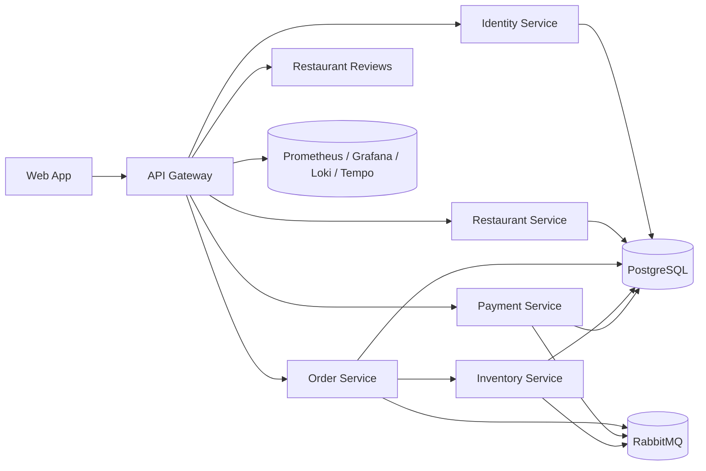

# FoodieGo

## 1. Project Overview
FoodieGo is a microservices-based food ordering platform with a React + Vite frontend, Node.js services, PostgreSQL, Redis, RabbitMQ, Docker Compose, GitHub Actions, and observability tooling.

The current repository is organized around these runtime services:
- `gateway` on port `3000`
- `identity-service` on port `3001`
- `restaurant-service` on port `3002`
- `order-service` on port `3003`
- `inventory-service` on port `3004`
- `payment-service` on port `3005`
- `web` served through Nginx on port `80` in Docker Compose

## 2. Features
- JWT authentication and role-based authorization for customer, merchant, driver, and admin users.
- Restaurant browsing, category browsing, menu management, and restaurant approval workflows.
- Cart, checkout, order tracking, delivery assignment, and delivery status updates.
- Payment processing with webhook verification, inbox/outbox persistence, and refund handling.
- Support ticket management for customers, merchants, and drivers.
- Promotion and voucher management with merchant approval flow.
- Event-driven integration with RabbitMQ, idempotency controls, and saga compensation.
- Observability through Prometheus metrics, Grafana dashboards, Loki logs, and Tempo traces.

## 3. Architecture Diagram


## 4. Microservices Description
| Service | Responsibility |
| --- | --- |
| `gateway` | Public entry point, routing, aggregation, rate limiting, and dashboard composition. |
| `identity-service` | Registration, login, profile management, address management, and admin user approvals. |
| `restaurant-service` | Categories, restaurants, menus, and restaurant review endpoints. |
| `order-service` | Cart, checkout, orders, delivery, support tickets, promotions, and admin order views. |
| `inventory-service` | Reservation workflow, stock tracking, inbox/outbox consumers, and expiration workers. |
| `payment-service` | Payment lifecycle, webhook validation, gateway adapters, reconciliation, and refunds. |
| `food-service` | CQRS-style food search and availability projections. It does not expose a public HTTP API. |

## 5. Folder Structure
```text
apps/
  gateway/
  identity-service/
  restaurant-service/
  order-service/
  inventory-service/
  payment-service/
  food-service/
  web/
packages/
  api-sdk/
  contracts/
  core/
  logging/
  metrics/
  otel/
  rabbit/
  shared-auth/
infrastructure/
  postgres/
  grafana/
  prometheus/
  tempo/
  promtail/
docs/
```

## 6. Tech Stack
- Frontend: React 19, Vite, TypeScript, React Query, Zustand, Tailwind CSS, Vitest, Playwright
- Backend: Node.js, Express, Jest, Supertest, pg, ioredis, amqplib
- Data: PostgreSQL, Redis, JSON Schema contracts
- DevOps: Docker Compose, GitHub Actions, SonarQube, Trivy, CodeQL, Gitleaks, Semgrep
- Observability: Prometheus, Grafana, Loki, Tempo, OpenTelemetry

## 7. Installation
```bash
git clone <repo-url>
cd FoodieGo
pnpm install
```

## 8. Docker Deployment
```bash
docker compose up -d --build
```

Primary local URLs after the stack starts:
- `http://localhost:3000` - API gateway
- `http://localhost:80` - Web app
- `http://localhost:3001` - Identity service
- `http://localhost:3002` - Restaurant service
- `http://localhost:3003` - Order service
- `http://localhost:3004` - Inventory service
- `http://localhost:3005` - Payment service

## 9. Local Development
```bash
pnpm dev
```

Useful service-specific commands:
```bash
pnpm --filter web dev
pnpm --filter gateway dev
pnpm --filter user-service dev
pnpm --filter restaurant-service dev
pnpm --filter order-service dev
pnpm --filter @foodiego/inventory-service dev
pnpm --filter payment-service dev
```

## 10. Environment Variables
Copy `.env.example` to `.env` and then configure the service-specific variables used in `docker-compose.yml`.

| Variable | Used By | Purpose |
| --- | --- | --- |
| `POSTGRES_USER`, `POSTGRES_PASSWORD`, `POSTGRES_DB` | Compose stack | PostgreSQL credentials and database name. |
| `REDIS_PASSWORD` | Identity, restaurant, order services | Redis authentication. |
| `RABBITMQ_USER`, `RABBITMQ_PASSWORD` | Order, inventory, payment services | RabbitMQ authentication. |
| `JWT_SECRET`, `JWT_EXPIRES_IN` | Gateway and identity service | JWT signing and lifetime. |
| `IDENTITY_SERVICE_URL` | Gateway, order service | Internal service URL for auth and user lookups. |
| `RESTAURANT_SERVICE_URL` | Gateway, order service | Internal service URL for restaurant and menu lookups. |
| `ORDER_SERVICE_URL` | Gateway | Internal service URL for order, cart, and support endpoints. |
| `PAYMENT_SERVICE_URL` | Gateway | Internal service URL for payment endpoints. |
| `OTEL_EXPORTER_OTLP_ENDPOINT` | Backend services | Tempo OTLP endpoint for tracing. |
| `GRAFANA_USER`, `GRAFANA_PASSWORD` | Grafana | Local Grafana login. |

## 11. API Documentation
The canonical endpoint list is in [docs/API_REFERENCE.md](/D:/CMU-SE%20433/Group%20Project/foodiego_update/FoodieGo/docs/API_REFERENCE.md).

The gateway is the normal public entry point. Service-local base URLs are documented in the API reference for direct testing.

## 12. Authentication
- Auth uses JWT bearer tokens.
- Send `Authorization: Bearer <token>` to protected routes.
- Customer, merchant, driver, and admin roles are enforced in the services and gateway.
- Checkout additionally requires an `Idempotency-Key` header.

## 13. Database Design
The PostgreSQL schema is documented in [docs/DATABASE.md](/D:/CMU-SE%20433/Group%20Project/foodiego_update/FoodieGo/docs/DATABASE.md).

The schema currently contains shared operational tables for:
- users and addresses
- restaurants, categories, and menu items
- carts, orders, order history, delivery, support tickets
- payments, webhook inboxes, and payment jobs
- promotions and promotion usage
- inventory reservations and stock
- outbox and inbox event tracking

## 14. Event Flow
The event-driven flows are documented in [docs/BUSINESS_FLOW.md](/D:/CMU-SE%20433/Group%20Project/foodiego_update/FoodieGo/docs/BUSINESS_FLOW.md).

The current implementation uses:
- outbox events for reliable publishing
- inbox tables for duplicate suppression
- webhook inboxes for payment deduplication
- saga compensation for payment and inventory failures

## 15. CI/CD Pipeline
The pipeline documentation is in [docs/CICD.md](/D:/CMU-SE%20433/Group%20Project/foodiego_update/FoodieGo/docs/CICD.md).

Tracked workflows:
- `build.yml`
- `ci.yml`
- `unit-test.yml`
- `contracts.yml`
- `security.yml`
- `release.yml`

## 16. Testing Guide
The testing strategy and commands are documented in [docs/TESTING.md](/D:/CMU-SE%20433/Group%20Project/foodiego_update/FoodieGo/docs/TESTING.md).

Current stored coverage artifacts show:
- `inventory-service`: 83.72% statements
- `food-service`: 77.78% statements
- `identity-service`: 37.80% statements
- `restaurant-service`: 5.04% statements
- `order-service`: 4.26% statements
- `payment-service`: no statement summary in the stored report

## 17. SonarQube
SonarQube notes and screenshot guidance are in [docs/SONARQUBE.md](/D:/CMU-SE%20433/Group%20Project/foodiego_update/FoodieGo/docs/SONARQUBE.md).

Important note: `sonar-project.properties` still references legacy source roots, so it should be reviewed before final submission.

## 18. Coverage Report
The repository contains per-service coverage artifacts under `apps/*/coverage`.

Latest stored values from the repository artifacts:

| Service | Statements |
| --- | --- |
| `inventory-service` | 83.72% |
| `food-service` | 77.78% |
| `identity-service` | 37.80% |
| `restaurant-service` | 5.04% |
| `order-service` | 4.26% |
| `payment-service` | 0.00% / no statement summary captured |

These results do not yet prove the full Level 2/3 coverage threshold for the whole repository.

## 19. Screenshots Section
Required evidence to attach before submission:
- GitHub repository visibility or collaborator access
- GitHub Actions green status for the final commit
- SonarQube dashboard and quality gate
- UI screenshots for customer, merchant, driver, and admin flows

## 20. Contributors
- FoodieGo team members as listed in [docs/SPQM_REPORT.md](/D:/CMU-SE%20433/Group%20Project/foodiego_update/FoodieGo/docs/SPQM_REPORT.md)
- Update this section if the final GitHub repository uses a different contributor list

## 21. License
MIT License. See [LICENSE](/D:/CMU-SE%20433/Group%20Project/foodiego_update/FoodieGo/LICENSE).

