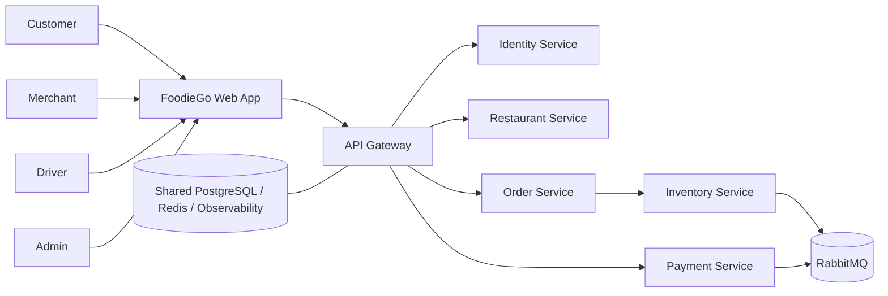
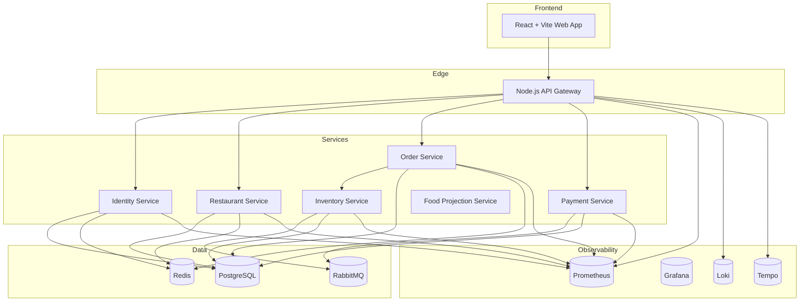
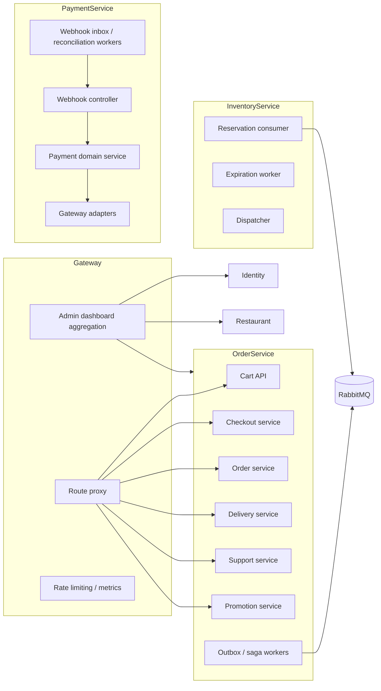
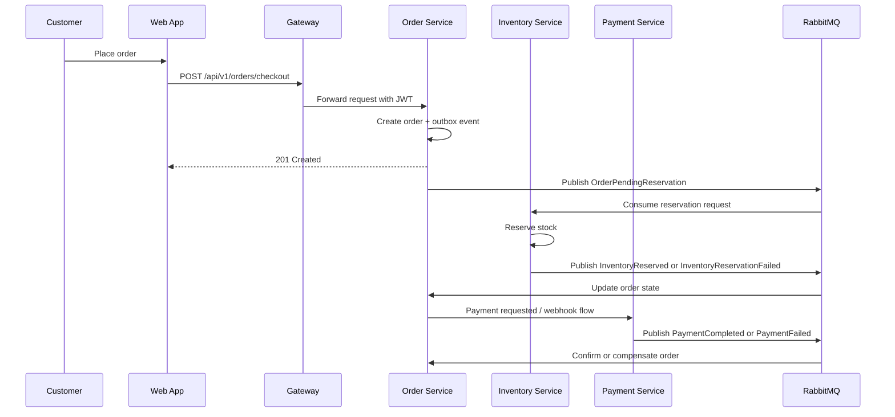
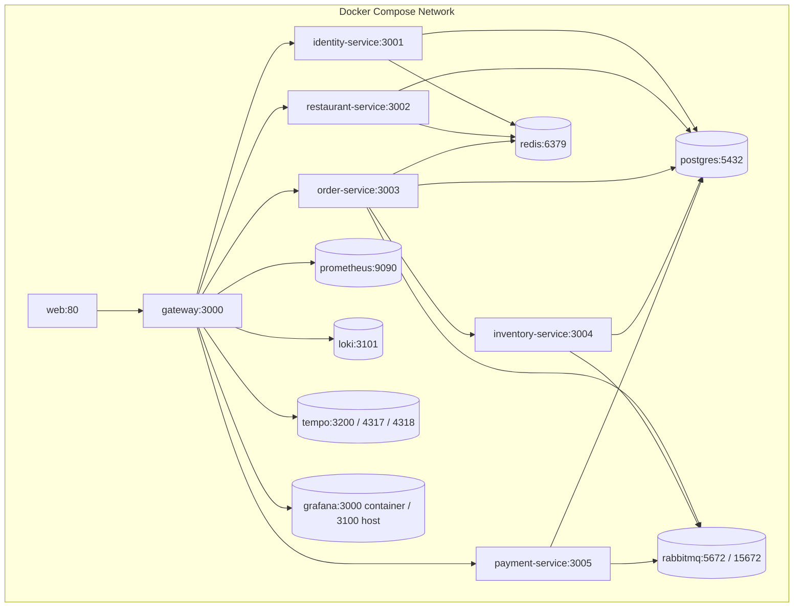

# Architecture

## 1. System Context

## 2. Container Diagram

## 3. Component Diagram

## 4. Checkout Saga Sequence

## 5. Deployment Diagram

## 6. Key Architectural Notes
- The gateway is the public edge, but the backend services remain independently runnable for local development and testing.
- The database is shared in this repository for submission practicality, even though the architecture is modeled as microservices.
- Reliable message handling is implemented through outbox/inbox tables and RabbitMQ consumers.
- `food-service` is a projection/read-model service rather than a request/response API.
- Observability is wired through Prometheus metrics, structured logging, and OpenTelemetry traces.
