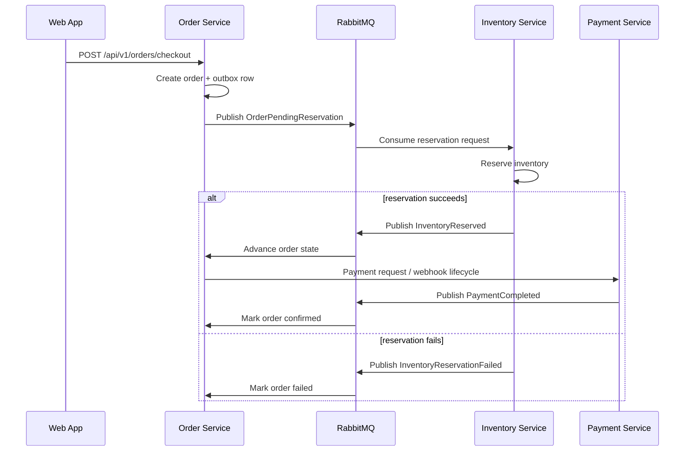

# Business Flow

## 1. Customer Flow
1. The customer signs up or logs in through `identity-service`.
2. The customer browses restaurants, categories, menu items, and reviews through `restaurant-service`.
3. The customer adds items to the cart in `order-service`.
4. Checkout starts with an idempotent request to `POST /api/v1/orders/checkout`.
5. The order is created, persisted with an outbox event, and forwarded into the inventory and payment saga.
6. The customer tracks the order in the web app using the order and delivery endpoints.

## 2. Merchant Flow
1. The merchant logs in through `identity-service`.
2. The merchant manages menu items through `restaurant-service`.
3. The merchant views order queues and order statistics through `order-service`.
4. The merchant submits vouchers through `POST /api/v1/promotions/merchant`.
5. Admin approval is required before merchant vouchers become active.

## 3. Driver Flow
1. A driver logs in and views available deliveries.
2. The driver accepts a delivery with `PATCH /api/v1/delivery/:id/accept`.
3. The driver updates delivery progress with `PATCH /api/v1/delivery/:id/status`.
4. Delivery statistics are available at `GET /api/v1/delivery/stats`.

## 4. Admin Flow
1. Admin reviews pending merchants and restaurants.
2. Admin approves or rejects users and restaurants.
3. Admin moderates categories, promotions, support tickets, and order status updates.
4. Admin views aggregate dashboard data through the gateway.

## 5. Order Lifecycle
The repository uses the following order-related states across services and database tables:

- `CREATED`: initial order row created.
- `PENDING`: awaiting reservation and payment flow.
- `CONFIRMED`: order has been accepted by the payment path.
- `PREPARING`: merchant is preparing the order.
- `READY`: ready for pickup.
- `PICKED_UP`: driver has collected the order.
- `COMPLETED`: customer received the order.
- `CANCELLED`: order was cancelled by business logic or compensation.
- `EXPIRED`: time window elapsed without completion.

## 6. Payment Lifecycle
Payment state is managed in `payment-service` and `webhook_inbox`:

- `CREATED`: payment row created from the request.
- `PENDING`: waiting for gateway/webhook confirmation.
- `AUTHORIZED`: payment authorized by the provider.
- `CAPTURED`: money captured by the provider.
- `REFUND_PENDING`: refund is in progress.
- `REFUNDED`: refund completed.
- `FAILED`: gateway or webhook reported failure.
- `EXPIRED`: payment attempt expired.

## 7. Inventory Lifecycle
Inventory uses reservation states stored in `inventory_reservations`:

- `CREATED`: reservation request received.
- `RESERVED`: stock held for an order.
- `CONFIRMED`: downstream order/payment flow succeeded.
- `RELEASED`: reservation was released.
- `EXPIRED`: reservation timer elapsed.

## 8. Saga Flow
The current distributed flow is event-driven and uses outbox/inbox persistence.

## 9. Compensation Flow
1. If inventory reservation fails, the order service marks the order as failed and emits a compensating event.
2. If payment fails, the order is not confirmed and the payment service emits `PaymentFailed`.
3. If payment is later cancelled, the refund path transitions the payment into `REFUND_PENDING` and eventually `REFUNDED`.
4. Webhook replay and inbox deduplication prevent duplicate side effects during retries.

## 10. Event Flow Notes
- `OrderPendingReservation` is validated against JSON Schema before consumption.
- `InventoryReserved` and `InventoryReservationFailed` are the inventory-side contract events.
- `PaymentCompleted` and `PaymentFailed` are the payment-side contract events.
- `OrderCancelled` and `OrderFailed` are compensation-oriented order events.
- RabbitMQ replay, inbox tables, and the payment webhook inbox make the flow resilient to retries and duplicate deliveries.
