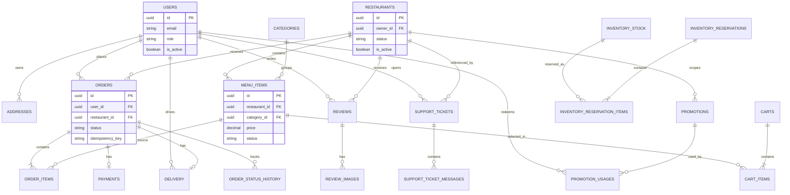

# Database Documentation

## 1. Scope
The repository uses a shared PostgreSQL instance for submission convenience. Service boundaries are still visible in the table design and in the migration ownership comments.

## 2. ER Diagram

## 3. Table Ownership
| Service | Owned tables |
| --- | --- |
| Identity service | `users`, `addresses`, `support_tickets` are shared-identity-adjacent tables used by the auth/admin flow. |
| Restaurant service | `restaurants`, `categories`, `menu_items`, `reviews`, `review_images` |
| Order service | `carts`, `cart_items`, `orders`, `order_items`, `order_status_history`, `delivery`, `promotions`, `promotion_usages`, `support_tickets` |
| Payment service | `payments`, `webhook_inbox`, `mock_gateway_jobs` |
| Inventory service | `inventory_stock`, `inventory_reservations`, `inventory_reservation_items` |
| Shared infrastructure | `outbox_events`, `inbox_events`, `dead_letter_events`, `replay_history`, `idempotency_keys` |

## 4. Key Tables and Relationships
- `users` has a unique email constraint and role checks for `customer`, `admin`, `driver`, and `merchant`.
- `restaurants.owner_id` references `users.id`.
- `menu_items.restaurant_id` references `restaurants.id`.
- `menu_items.category_id` references `categories.id`.
- `orders.user_id` references `users.id`.
- `orders.restaurant_id` references `restaurants.id`.
- `orders.address_id` references `addresses.id`.
- `order_items.order_id` references `orders.id`.
- `order_items.menu_item_id` references `menu_items.id`.
- `delivery.order_id` is unique and references `orders.id`.
- `reviews.order_id` is unique and references `orders.id`.
- `promotions.restaurant_id` is nullable for platform promotions and populated for merchant vouchers.
- `promotion_usages` tracks consumption of a promotion by user and order.

## 5. Indexes
Representative indexes from the migrations:
- `idx_users_email`, `idx_users_role`
- `idx_addresses_user_id`
- `idx_restaurants_status`, `idx_restaurants_name_trgm`, `idx_restaurants_deleted_at`
- `idx_menu_items_restaurant`, `idx_menu_items_category`, `idx_menu_items_name_trgm`
- `idx_orders_user_id`, `idx_orders_status`, `idx_orders_restaurant`
- `idx_order_items_order`
- `idx_outbox_status`, `idx_outbox_status_lease`, `idx_outbox_unpublished`
- `idx_inv_res_order`, `idx_inv_res_status_expires`, `idx_inv_res_items_res`
- `idx_payments_order_id`, `idx_payments_status`
- `idx_promotions_code`, `idx_promotions_restaurant_id`, `idx_promotions_approval_status`, `idx_promotions_type`
- `idx_support_tickets_customer`, `idx_support_tickets_order`, `idx_support_tickets_status`, `idx_support_tickets_admin`
- `idx_reviews_user_id`, `idx_reviews_restaurant_id`, `idx_reviews_order_id`, `idx_reviews_rating`

## 6. Constraints
- `users.role` is constrained to the supported roles.
- `restaurants.status` and `menu_items.status` are constrained by enum-like `CHECK` clauses.
- `orders.idempotency_key` is unique.
- `order_items.quantity` and `cart_items.quantity` must be positive.
- `delivery.status` must be one of `waiting`, `accepted`, `picked_up`, `delivering`, `delivered`.
- `reviews.rating` must be between `1` and `5`.
- `promotions.discount_type`, `promotion_type`, and `approval_status` are constrained values.
- `inventory_stock.reserved_quantity` cannot exceed `total_quantity`.
- `payments.idempotency_key` is unique and not null.
- `support_tickets.status` and `support_ticket_messages.is_internal` support the ticket workflow.

## 7. Important Operational Tables
- `outbox_events` supports reliable publication of domain events.
- `inbox_events` and `webhook_inbox` prevent duplicate processing.
- `dead_letter_events` and `replay_history` support poison-message handling and replay.
- `idempotency_keys` keeps checkout requests safe across retries.
- `mock_gateway_jobs` supports asynchronous payment gateway simulation.

## 8. Seed Strategy
The repository contains both deterministic and realistic seeds:
- `infrastructure/postgres/seed.sql` for starter content
- `infrastructure/postgres/migrations/015_realistic_seed_data.sql` and `016_perfect_seed_data.sql` for richer demo content
- `infrastructure/postgres/migrations/017_business_spec_align.sql` for aligning the schema with the current business flow
